	

	<a href="https://github.com/kido449">PROFILE</a>
	&nbsp; / &nbsp;
	<a href="https://github.com/kido449?tab=repositories">WORK</a>
	&nbsp; / &nbsp;
	<a href="https://github.com/users/kido449/contributions">CONTRIBUTIONS</a>

## 01 / Point of view

I work across applied AI and full-stack product engineering. The work here explores three things: safer agent systems, better tools for animal-rescue teams, and software that makes sustainability more tangible.

## 02 / Selected work

### AgentArmor

An AI-agent security gateway that inspects untrusted tool output, applies policy actions, and streams telemetry to a dashboard.

`Python` `TypeScript` `Moss` `Groq` `Gemini`  ·  [Source](https://github.com/kido449/AgentArmor)

### PawsMatch / ShelterOps

An agent-assisted rescue operations product for animal-applicant matching, multilingual intake, and shelter workflow support. Built for the AWS Agents for Humans hackathon, Good Neighbor Agents track.

`Python` `FastAPI` `React` `Strands Agents` `Gemini` `Sarvam AI` `SQLite`  ·  [Source](https://github.com/kido449/pawsMatch) · [Live app](https://paws-match-zeta.vercel.app/)

### Terra

A sustainability platform for personal carbon-footprint awareness, what-if impact simulations, and habit building. Built for Prompt Wars Virtual, Challenge 3.

`React` `Vite` `Tailwind CSS` `Chart.js`  ·  [Source](https://github.com/kido449/terra-eco-tracker)

## 03 / Toolkit

**AI & agent systems**  ·  Gemini, Groq, Strands Agents, Moss

**Application engineering**  ·  Python, FastAPI, TypeScript, React, Vite

**Data & interface**  ·  SQLite, Chart.js, Tailwind CSS

## 04 / Activity

GitHub hosts my **[live contribution graph](https://github.com/users/kido449/contributions)**. No third-party activity estimates or contribution totals are embedded here.

## 05 / Elsewhere

[GitHub profile](https://github.com/kido449)  ·  [All public repositories](https://github.com/kido449?tab=repositories)

	

